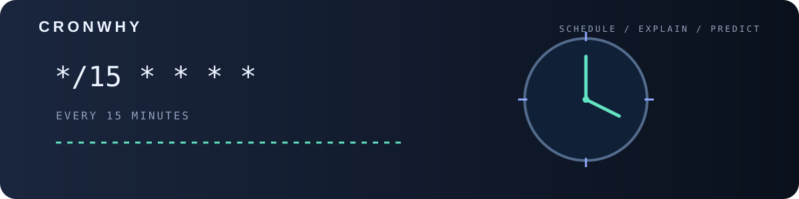

<p align="center">

<p align="center"></p>
  
</p>

<p align="center">
  
  
  
</p>

**cronwhy** is a single Python file that explains any cron expression in plain English
and shows exactly when it will run next. No `pip install`, no dependencies. Download one file and run it.

<p align="center">
  
</p>

## Run

```bash
python cronwhy.py "*/15 9-17 * * 1-5"
```

Quotes are optional: `python cronwhy.py 30 2 * * sun`

Or grab just the file:

```bash
curl -O https://raw.githubusercontent.com/ERROR404DTIR/cronwhy/main/cronwhy.py
```

## Options

| Option | What it does |
|---|---|
| `expr` | Cron expression (5 fields) or a macro like `@daily`, `@hourly`, `@weekly` |
| `-n, --count N` | How many upcoming runs to show (default 5) |
| `--from "YYYY-MM-DD HH:MM"` | Calculate from this time instead of now |

## Supported syntax

- Lists `1,15`, ranges `9-17`, steps `*/5` and `10-50/10`
- Month and day names: `jan`, `sun`, `mon-fri`
- `7` as Sunday, `?` as `*`
- Classic cron rule: when both day-of-month and day-of-week are set, either one can match
- Impossible schedules (like February 30) are detected and reported

## Examples

```bash
python cronwhy.py "0 0 1 * *" -n 12
python cronwhy.py @daily --from "2026-12-31 23:00"
python cronwhy.py "0 9 * * mon-fri"
python cronwhy.py "*/10 * * jan,jul *"
```

## Why

- **One file**, readable in a few minutes
- **Zero dependencies**: only the Python standard library
- **Offline**: nothing is sent anywhere
- Works on Windows, Linux and macOS

## License

MIT